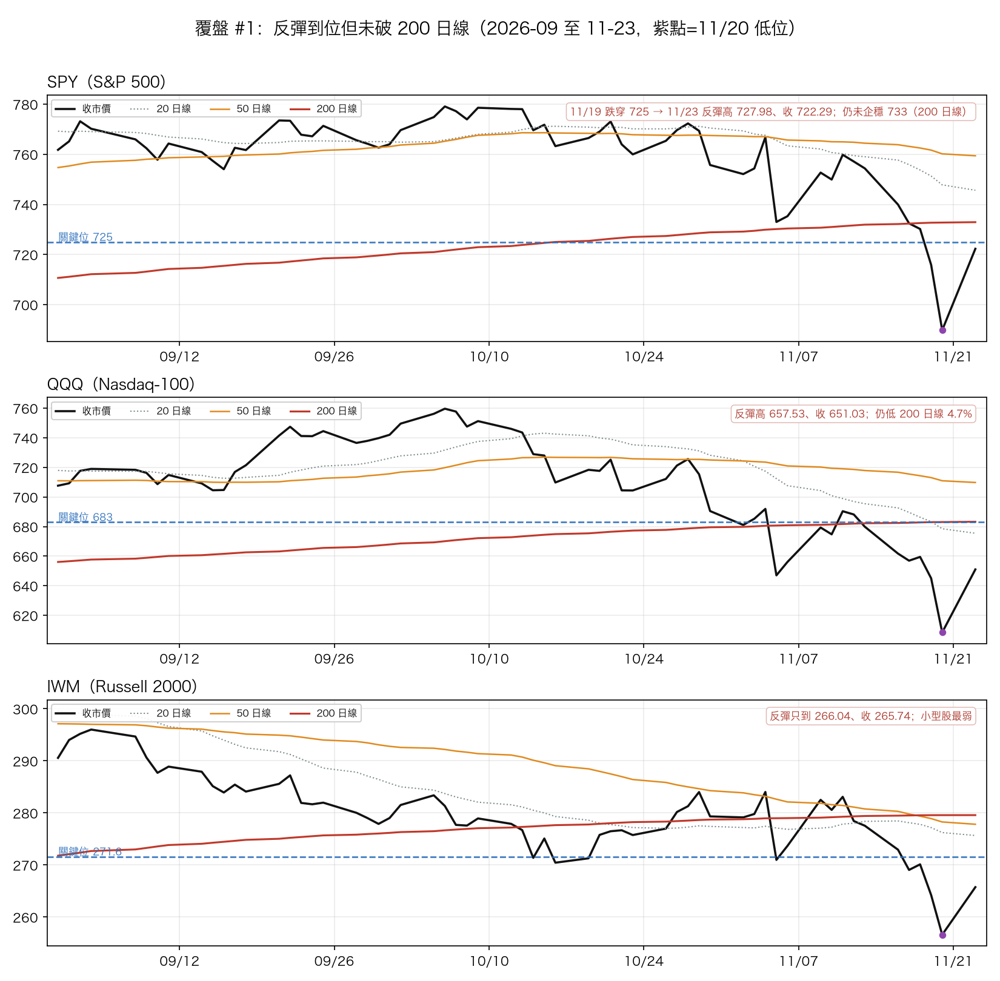
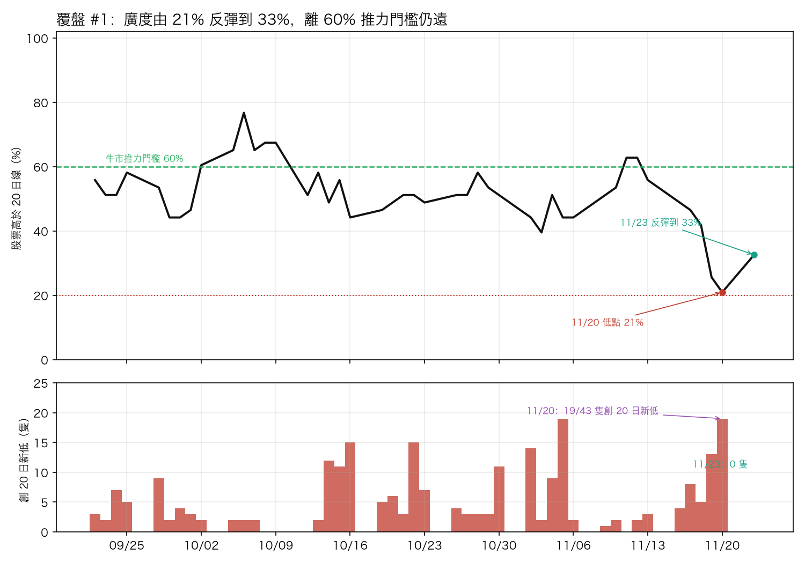
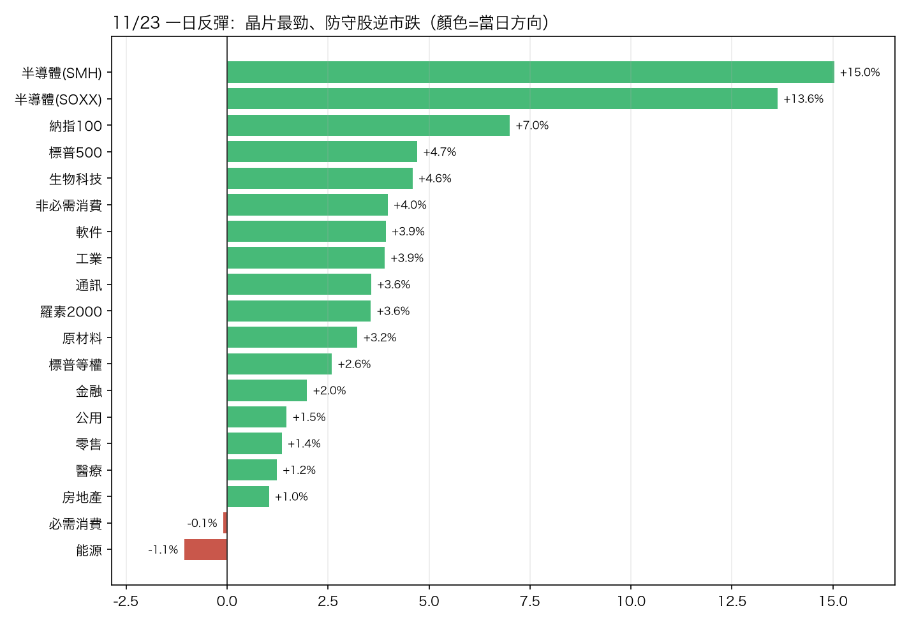

# 📋 覆盤與修訂記錄 — Stan Weinstein 報告（2026-11）

> **呢頁用途**：每次覆盤按日期順序記錄，方便核對「當時點講、後來點樣」。同一日嘅覆盤如有重大補充，會以 **v2／v3** 標示並保留修訂說明。
> **原報告（11/22 原版，凍結存檔）**：[Stan Weinstein 訪問驗證 × 後市行動手冊]({{ '/stan-weinstein-stage-analysis-2026-11.html' | relative_url }})

## 目錄

| 覆盤 | 數據截至 | 一句結論 |
|---|---|---|
| [#1 — 2026-11-24（v2 全面版）](#覆盤-12026-11-24v2-全面版) | 11/23 美收 + 11/24 亞洲時段 | 反彈係消息+空頭回補，非廣度推力；指數 gap 即日補、分布日 9 個未清、信貸/美元唔配合 → 熊市反彈，減倉窗口已開 |

---

## 覆盤 #1：2026-11-24（v2 全面版）

> **修訂記錄**：v1（11/24 13:00 HKT，精簡版）→ **v2（11/24 15:20 HKT，全面重寫）**：補回廣度統計、分布日、缺口分析、信貸/美元/貴金屬、亞洲時段跟進、反彈質量評分。

**數據截止**：美股 2026-11-23 收市（星期一）；亞洲時段 2026-11-24 15:00 HKT。

### 0. 五點結論

1. **反彈幅度超預期，但質量唔合格。** SPY +4.71% 收 722.29（高位 727.98）、QQQ +7.00% 收 651.03，正好停喺原報告寫嘅 725 / 645–660 區間；但指數**即日補回上升缺口**，只有 2% 股票創 20 日新高——係「熊市反彈」而唔係「突破」。
2. **唯一強勢分支係晶片/AI。** NVDA +31.48%（成交 4.39 倍）、SMH +15.03%、SOXX +13.63%，三者嘅**上升缺口都未補**，短線資金明顯集中喺呢度。
3. **機構派貨未停。** 過去 25 個交易日，SPY 同 QQQ 各有 **9 個分布日**（跌 >0.2% 且成交增），IWM 7 個——歷史上呢個讀數係「大市受壓」，唔係「見底」。
4. **宏觀三條支柱全部逆向。** 美元 UUP 創 52 週新高（RSI 75）、10 年債息 4.934% 兼 12 月加息機率 90%、貴金屬崩（GLD 低 200 日線 17.8%、SLV 低 36%）——流動性收縮，股市反彈屬「無根基」。
5. **行動不變，但更清晰。** SPY 727–733、QQQ 657–676 分批減 Stage 4 持倉；唔追 +20~31% 嘅單日消息股；等 11/25 PCE 同 12/9 FOMC，最快 11/25 先有可能出現 follow-through day。

### 1. 反彈質量評分（10 項指標，3 好 7 淡）

*紫點 = 11/20 低位。三隻指數都係由 200 日線下方反彈，未有一隻能重返 200 日線之上。*

| # | 指標 | 讀數（11/23） | 判讀 |
|---|---|---|---|
| 1 | 指數缺口 | SPY 開 724.33、低 713.53 → **即日補回**；QQQ、IWM 同樣 | ❌ 弱：唔係突破性缺口 |
| 2 | 龍頭缺口 | NVDA 143.72–167.03、SMH 438.44–469.02、SOXX 135.41–142.11 **全部未補** | ✅ 強：晶片有實質買盤 |
| 3 | 廣度（20 日線） | 43 隻股票只有 **33%** 喺 20 日線之上 | ❌ 普漲基礎薄弱 |
| 4 | 廣度（50／200 日線） | 47% / 49% | ❌ 一半股票仍在下降趨勢 |
| 5 | 新高／新低 | 11/20：**44% 創 20 日新低**；11/23：0% 新低但只有 2% 新高 | ❌ 由恐慌轉橫行，未轉強 |
| 6 | 分布日（25 日） | SPY 9、QQQ 9、IWM 7 | ❌ 機構持續減倉 |
| 7 | 成交量 | SPY 1.79x、QQQ 1.90x、NVDA 4.39x 50 日均量 | ⚠️ 有量，但集中喺消息股 |
| 8 | 信貸 | HYG 低 200 日線 3.4%、LQD 低 3.0% | ❌ 債市唔確認 risk-on |
| 9 | 美元 | UUP 29.78，52 週新高，RSI 75.1 | ❌ 收緊、壓新興市場 |
| 10 | 利率 | 10Y 4.934%（11/20 為 4.95%），12/9 加息 90% | ❌ 估值逆風未除 |

*上圖：43 隻股票中高於 20 日線嘅比例；下圖：每日創 20 日新低嘅股票數。11/20 有 19/43 隻創 20 日新低（恐慌），11/23 降到 0，但廣度只返到 33%，未夠 60% 嘅推力門檻。*

**一句**：呢個係「超賣 + 事件」帶動嘅反彈，唔係「廣度 + 信貸 + 美元」三者配合嘅新一輪上升。

### 2. 對照原報告（11/22）嘅命中與偏差

| 原報告講法 | 實際（11/23） | 判定 |
|---|---|---|
| SPY 反彈目標 715 → **725** → 733（200 日線） | 高 727.98，收 722.29 | ✅ 命中 725，未到 733 |
| QQQ 反彈目標 645 → 660 → 683 | 高 657.53，收 651.03 | ✅ 停喺預測區間 |
| IWM 反彈目標 269 → 279.6 | 高 266.04 | ❌ 差 1.1%，小型股明顯落後 |
| 「反彈係出貨/做空位，唔係買入位」 | 高位回落、指數補 gap | ✅ 邏輯成立 |
| 「VIX 跌回 25 以下 = 恐慌消退」 | 26.62（-25.8%） | ⏳ 未確認 |
| 「10Y 升穿 5% = 估值再壓」 | 4.934% | ⏳ 未觸發，但方向向上 |
| 防守股（COST／XLV／XLP／MCK）可留 | COST -0.38%、MCK -1.96%、XLP -0.09% 逆市跌 | ⚠️ 短線輪動出去，趨勢未破，紀律仍有效 |
| SOXX 距高位 -43.5%（Stage 4） | 反彈後仍 -35.8%、低 200 日線 13% | ✅ Stage 4 未變 |

**偏差檢討**：原報告低估咗「管理層變動」呢類事件驅動反彈嘅力度（NVDA 一日 +31.5%）。呢點屬不可預測事件，但可以改進嘅係——**原報告應該講明「Event risk 可以令超賣反彈超出目標區間」**，而唔係只寫價位。

### 3. 板塊與個股：邊個真強、邊個假彈

| 組別 | 代表 | 11/23 | 相對 50 日線 | 判讀 |
|---|---|---|---|---|
| 記憶體／伺服器 | MU +19.0%、DELL +20.5%、SMCI +13.3% | 大反彈 | MU -22.1%、DELL -28.3% | 深度 Stage 4 反彈，未轉勢 |
| 晶片設備 | AMKR +15.1%、ACMR +13.5%、CAMT +12.2%、TSM +14.1% | 大反彈 | -20% 至 -24% | 同上，gap 未補係唯一支撐 |
| 工業 | CAT +7.2%、FIX +11.1% | 反彈 | CAT -22.9%、FIX -17.6% | Stage 4，反彈減倉 |
| 防守 | XLP -0.1%、COST -0.4%、MCK -2.0%、JNJ -0.2% | 逆市跌 | 仍高於 50 日線 | Stage 2 未破，持倉紀律 |
| 醫療 | IBB +4.6%、XLV +1.2% | 跟升 | IBB 貼 50 日線、高 200 日線 11.1% | **結構最好**，回調可留意 |
| 能源 | XLE -1.1% | 逆市跌 | -7.3%，RSI 32.8 | 最弱勢，唔好撈 |
| 貴金屬 | GLD -32.9%（距高位）、SLV -63% | 反彈但仍崩 | GLD -10.9%、SLV -23.2% | 深度 Stage 4，避開 |
| 金融 | XLF +2.0%、KRE +1.8% | 跟升 | XLF -0.4%、KRE -2.4% | 中性偏弱 |

*11/23 單日：半導體 +13.6~15.0% 領漲，能源同必需消費逆市下跌——典型「風險開」輪動，唔係全面復甦。*

**亞洲時段（11/24）**：日經 +3.91%、KOSPI +6.32%、台灣加權 **+8.99%**（晶片權重最高）；但恒指 **-0.67%**、上證 +0.12%——資金只買 AI/半導體，唔買中國資產，進一步證明呢個係「AI 修復交易」而非「全球 risk-on」。

### 4. 關鍵價位（更新）

| 資產 | 11/23 收 | 支持 | 阻力 | 備註 |
|---|---|---|---|---|
| SPY | 722.29 | 713.53（11/23 低）→ 706 → 686.75 | 727.98 → **732.92**（200 日線）→ 739.90 → 759.41（50 日線） | 733 企穩 3 日先叫反彈升級 |
| QQQ | 651.03 | 641.95 → 606.23 | 657.53 → 676.49 → **683.27**（200 日線） | 683 係分水嶺 |
| IWM | 265.74 | 262.86 → 256.32 | 266.04 → 273.05 → 279.57（200 日線） | 小型股最弱 |
| NVDA | 165.05 | **156.93（gap 底）** → 143.72 | 171.50 → 183 → 206.08（50 日線） | 跌穿 156.93 = 反彈失敗 |
| SOXX | 140.22 | 136.64（gap 底） | 148.59 → 161.09（200 日線） | 同上 |
| VIX | 26.62 | 24–25 | 30 / 35.89 | 跌穿 25 先叫恐慌退 |
| 10Y | 4.934% | 4.90% | **5.00%** | 升穿 5% 全面加壓 |
| UUP（美元） | 29.78 | 29.40 | 30.00 | 52 週高，強美元 = 股市逆風 |

### 5. 情境更新（未來 2–4 週）

| 情境 | 機率 | 觸發條件 | 路徑 | 應對 |
|---|---|---|---|---|
| **A. 反彈失敗（基本）** | 55% | 11/25 PCE 高於預期、或聯儲官員放鷹；跌穿 SPY 713.5 / QQQ 642 | SPY 706 → 686.75 → 660；QQQ 620 → 606 → 570 | 反彈區間分批減倉；跌穿 713.5 可短線做空 |
| **B. 反彈延伸** | 27% | PCE 溫和，SPY 企穩 733 三日 | SPY 739.9 → 759（50 日線）；QQQ 676 → 683 → 710 | 到 50 日線照減；唔當轉勢 |
| **C. 真正見底** | 18% | Follow-through day（最快 11/25 第 4 日）+ 廣度 >60% + HYG 重上 200 日線 + 美元回落 | 橫行 5–8 週建 Stage 1 | 等 Stage 1 完成先買 |

**Follow-through day 框架**：11/20 係近期低點（day 1），11/23 = day 2、11/24 = day 3，最快 **11/25（星期三，PCE 日）** 才符合 day 4 條件；而且需要當日大市升 >1.5% 兼成交高於前一日。而家 **0/4 條件成立**。

### 6. 行動清單（比原報告更具體）

1. **減倉節奏**：SPY 727–730 減第一批、731–733 減第二批；QQQ 657–665 第一批、670–676 第二批。唔好一次過市價掟，用限價。
2. **對沖替代**：唔想賣貨可以買 SPY 12/18 700/670 put spread（成本約 1.0–1.3%），或 QQQ 620/590。
3. **唔好做嘅事**：唔好追 NVDA／MU／DELL 呢類單日 +20~31% 嘅股票；NVDA 跌穿 156.93 就係止蝕參考，唔好喺 165 追。
4. **觀察名單（等回調）**：IBB（結構最好，等回 50 日線 208.9）、XLV（176.7）、COST（等 50 日線 990）、GDYN／IBTA／EPAM（Stage 2 但距高位遠）。
5. **重新入場四條件**：FTD 出現 + 廣度 >60% 股票喺 20 日線之上 + HYG 重上 200 日線 + UUP 由 52 週高回落。四項齊兩項先考慮半注。
6. **倉位**：12/9 FOMC 前總倉位 ≤30%，單一部位 ≤5%，唔好持大倉過感恩節（11/26–27 半日市）。

### 7. 風險清單（按時間排序）

- **11/25（三）08:30 ET**：10 月 PCE——12/9 前最後一份乾淨通脹數據，市場預期核心 PCE 仍高；數據爆高會即時殺死反彈。
- **11/26–27**：感恩節假期，成交薄、假突破多，唔好做大決定。
- **12/9**：FOMC，加息 25 點子機率 90%（上週 93%，略降），terminal rate 已 price in 4.44%。
- **未結案事件**：NVDA 會計調查（SEC）、Huang 國會聽證（下月）、政府停擺風險、美伊局勢。
- **流動性**：美元 52 週高 + 貴金屬崩 + 信貸弱 = 全球美元流動性收緊，股市反彈嘅持續性存疑。

### 8. 方法與限制

- 廣度樣本：43 隻美股（大型股為主，非全市場），方向可信、絕對值有偏差。
- 分布日定義：跌幅 >0.2% 且成交量高於前一日，統計最近 25 個交易日。
- 缺口定義：當日開盤高於前一日最高（上升缺口）／低於前一日最低（下跌缺口）。
- 亞洲數據截至 11/24 15:00 HKT；美股 11/24 未開市，本覆盤未包含 11/24 美股走勢。
- 以上為技術分析框架應用，**唔構成投資建議**。

---

*覆盤 #1（v2）— 2026-11-24 15:20 HKT ・ [原報告（11/22 版）]({{ '/stan-weinstein-stage-analysis-2026-11.html' | relative_url }}) ・ [← 返回首頁]({{ '/' | relative_url }}) ・ [GitHub Repo](https://github.com/kiuckhuang/investment-sharing)