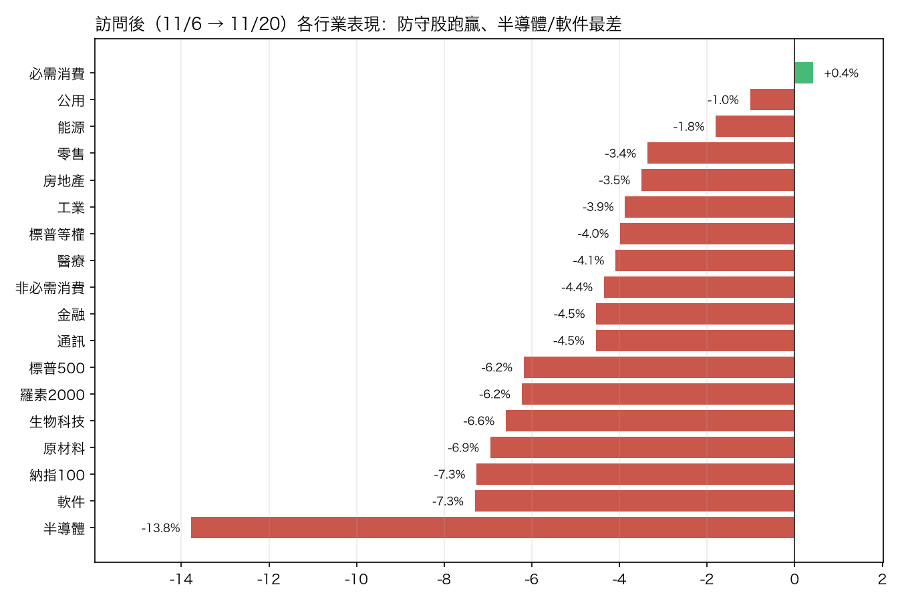
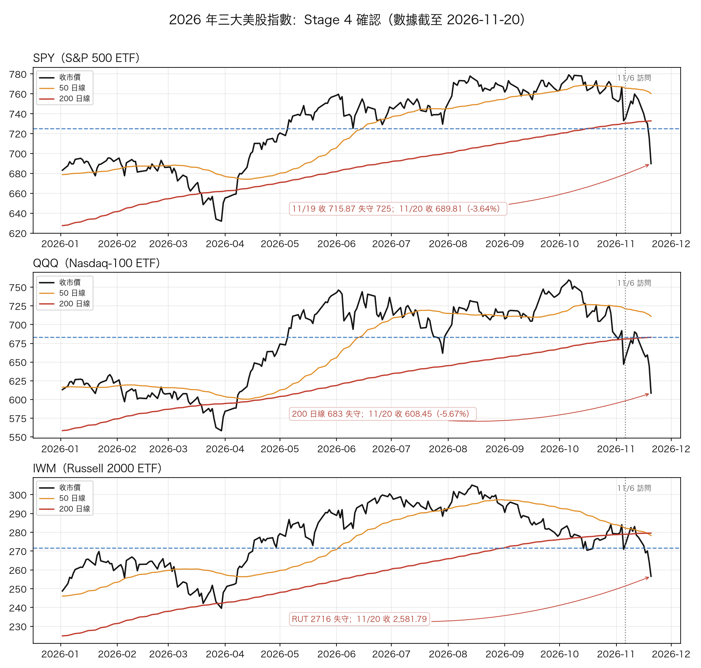

# Stan Weinstein 訪問驗證 × 後市行動手冊（2026-11）

**發佈日期**：2026-11-22 ｜ **美股數據截至**：2026-11-20（星期五）收市  
**系列**：[投資分享首頁]({{ '/' | relative_url }}) ・ Stage Analysis 實戰驗證 #1  
**訪問來源**：[TraderLion Podcast《Trading Lessons from 60+ Years in the Market — Exclusive with Stan Weinstein》](https://www.youtube.com/watch?v=PRRNI5SrUWY)，YouTube 上架 2026-11-09  
**方法**：YouTube 音頻逐字轉錄核對原文，再用日線價量（[Nasdaq](https://www.nasdaq.com)、[Yahoo Finance](https://finance.yahoo.com)、[CNBC](https://www.cnbc.com)）計 50/150/200 日線、Stage、廣度同板塊表現。

---

## 0. 先講結論（五點）

1. **訪問嘅關鍵價位，兩星期內全部應驗。** Stan 講 SPY 跌穿 725 就「hell breaks loose」，11 月 19 日收 715.87 失守，11 月 20 日再插 3.64% 至 689.81；RUT 跌穿 2716 亦喺 11 月 17 日左右發生，星期五收 2,581.79。
2. **QQQ 嘅 Stage 3 → Stage 4 判斷準確。** 錄音當日（11 月 6 日）QQQ 已經低過 200 日線，星期五收 608.45，低 200 日線 10.9%，距 10 月 6 日高位 -19.9%。
3. **但係時序有出入：訪問出街後先反彈五日，然後先爆。** 11 月 9 至 13 日 SPY 由 735 升到 759.81、QQQ 由 656 升到 690，之後 11 月 16 至 20 日全數跌凸。呢個正正係 Stan 講嘅「oversold bounce 係出貨位，唔係買入位」。
4. **今日已經係 Stage 4，唔係「就快跌入 Stage 4」。** SPY、QQQ、IWM 全部跌穿 200 日線，50 日線向下，200 日線仍然上升（4A 初期）。按 Stan 嘅規矩：Stage 4 唔買、唔撈底、唔加注。
5. **下一個動作唔係「買咩」，而係「減幾多、幾時再買」。** 短線超賣（SPY RSI 24.9、VIX 35.89）隨時有報復性反彈，但反彈係減倉/做空位；中長線要等 Stage 1 底部，最快 2027 年第一季。

---

## 1. 訪問基本資料校正

| 項目 | 原始筆記 | 查證結果 | 備註 |
|---|---|---|---|
| 頻道 | Trailine Podcast | **TraderLion** | 主持 Richard Moglen 嘅頻道 |
| 主持 | Richard Mglin | **Richard Moglen** | 拼寫更正 |
| 上架日期 | （未寫） | **2026-11-09** | 距今 13 日 |
| 片長 | （未寫） | 74 分鐘 | |
| 標題 | （未寫） | Trading Lessons from 60+ Years in the Market | |
| 錄音時間 | （推算） | **2026-11-06（五）或之後** | 因為講「next session or two on Monday, Tuesday」同「Thursday night… Friday」 |

**逐字核對嘅關鍵句**（全長 74 分鐘轉錄）：

- 「I think that probably I've said **65 to 70 percent** of the stocks have seen the high for the cycle.」✔️ 同筆記一致
- 「If the SPYs break below, I think it's **725**, hell is going to break loose.」✔️
- 「you close below that **2716**, boom. As bad as the market's been, it'll let me get worse.」✔️
- 「in late August, I turned negative technically」✔️

**代號核對**：大部分代號正確（COST、GOOGL、CAT、BLK、AMKR、CAMT、ACMR、GIL、AS、EPAM、GDYN、MCK、PLNT、ADMA、CCSI、P、BSY、ARDT、IBTA、MAZE、KD、RWAY 都係真實上市公司）。只有 **A&DG、APN、ECG、ADA** 對唔上現成代號，好可能係轉錄雜訊；如果要跟住做，記得用公司全名再核對圖表。

---

## 2. 訪問出街之後發生咩事（時間線）

| 日期 | 事件 | SPY | QQQ | IWM | 備註 |
|---|---|---|---|---|---|
| 11/6（五） | **錄音** | 735.29 | 656.10 | 273.67 | SPY 200 日線 730.39（即「one inch above」）；QQQ 已低於 200 日線 680.89 |
| 11/9–11/13 | 報復性反彈 | 759.81（11/11 高） | 690.38（11/11 高） | 283.09 | 市場一度以為冇事，QQQ 重返 200 日線樓上兩日 |
| 11/16–11/20 | **爆邊** | 689.81 | 608.45 | 256.61 | 一星期 SPY -8.56%、QQQ -10.51%、SOXX -17.35% |
| 11/19（四） | **SPY 失守 725** | 715.87 | 645.04 | 264.22 | Stan 講嘅觸發位正式失守 |
| 11/20（五） | 恐慌日 | 689.81（-3.64%，成交量 3.07 倍） | 608.45（-5.67%） | 256.61（-2.88%） | VIX 35.89（+26.2%）、10 年債息 4.95% |

**一句總結**：Stan 嘅路線圖係「先反彈、後爆邊」，市場照做，只係反彈比佢預期更強、爆得更急。

---

## 3. 逐項驗證：訪問講法 vs 市場實況

（數據截至 2026-11-20 收市；「判定」係用價量同 Stage 規則核對嘅結果。訪問內容經音頻逐字轉錄核對。）

| # | 訪問講法 | 實況 | 判定 |
|---|---|---|---|
| 1 | 3 月底至 8 月中係 mini bull，8 月中係真頂 | IWM 8 月 14 日見 305.09（52 週高）；但 SPY/QQQ 10 月 6 日才見頂（779.09 / 759.66） | **部分準確**：小型股 8 月中見頂，大型科技遲咗七個星期 |
| 2 | 65–70% 股票已見週期高位 | 無法直接核實。47 隻樣本：11/6 有 55.3% 仍高於 200 日線，11/20 跌至 42.6%；47% 樣本嘅 52 週高喺 7 月前已出現 | **方向正確**，數字視乎樣本；細價股比例肯定更差 |
| 3 | QQQ 由 Stage 3 頂部跌入 Stage 4 | 11/6 已低於 200 日線；11/20 收 608.45，低 200 日線 10.9%、低 50 日線 14.4%，距高位 -19.9% | **完全命中** |
| 4 | SPY 跌穿 725 就 hell breaks loose | 11/19 收 715.87 失守；11/20 再跌 3.64% 至 689.81，成交 3 倍 | **完全命中**（一日後應驗） |
| 5 | RUT 跌穿 2716 會再差 | 11 月 17 日左右失守（IWM 269.05 ≈ RUT 2,707）；11/20 收 2,581.79 | **完全命中** |
| 6 | 半導體係典型 Stage 4 | SOXX 123.40，低 200 日線 23.3%，距 6 月 22 日高位 -43.5%；SMH 同類 | **完全命中**，而且係最傷嘅一群 |
| 7 | 油服務弱 | XLE 仍高於 200 日線 1.3%，但低 50 日線 6.5%，距高位 -13.6% | **部分命中**：弱勢，但未確認 Stage 4 |
| 8 | 醫療/生物科技、軟件、支付、零售有得做 | XLV 高於 200 日線 10.2%、貼 50 日線；XRT 貼 50 日線；但 IBB 已失 50 日線、IGV 已失 200 日線 | **部分命中**：醫療最強，軟件已轉弱，生物科技開始散水 |
| 9 | 長倉名單（COST、MCK、EPAM、GDYN、IBTA、ARDT…） | COST +12.6% 高於 200 日線、距高位只 -1%；MCK +21.6%；EPAM +29.9% 但距高位 -30.8%；ARDT 訪問後 -12.8% | **選股正確、持倉管理要跟**：股份仲喺 Stage 2，但回撤唔細 |
| 10 | 短倉名單（GOOGL、CAT、GIL、AMKR、CAMT、ACMR、AS） | GOOGL -21.3% 低於 200 日線；CAT -36.5%；GIL -38.4%；AMKR -46.2%；CAMT -42.2%；ACMR -41.4%；AS -14.9% | **完全命中**，全部深度 Stage 4 |
| 11 | 「85–90% 嘅 gap 最終會補」 | 一般規則，唔係本次預測 | 無法驗證，但符合今年多次 gap 回補嘅走勢 |
| 12 | 「黑雲蓋頂」即刻走，唔等 200 日線 | 11/20 大陰燭、開高收低、跌穿前低位 = 典型黑雲 | **規則已觸發**：跟規則嘅話，11/20 已經減倉/清倉 |

---

## 4. 今日市場掃描（2026-11-20 收市）

### 4.1 指數與波動率

| 指標 | 收市 | 單日 | 一週 | 距 52 週高 | 50 日線 | 200 日線 | 位置 |
|---|---|---|---|---|---|---|---|
| S&P 500 | 6,910.39 | -3.70% | -8.6% | -10.6%（10/6 頂） | — | — | 跌入調整區 |
| SPY | 689.81 | -3.64% | -8.56% | -11.46% | 760.18 | 732.76 | **低 200 日線 5.9%** |
| Nasdaq 100 | 25,028.98 | -5.61% | — | -20%（日內） | — | — | **技術性熊市** |
| QQQ | 608.45 | -5.67% | -10.51% | -19.90% | 710.96 | 683.06 | **低 200 日線 10.9%** |
| Russell 2000 | 2,581.79 | -2.76% | -7.5% | — | — | — | 失守 2,716 |
| IWM | 256.61 | -2.88% | -7.54% | -15.89% | 278.26 | 279.57 | **低 200 日線 8.2%** |
| 道指 | 48,147.33 | -1.93% | -8.0% | — | — | — | 跌穿 50,000 |
| VIX | 35.89 | +26.2% | — | — | — | — | 3 月以來最高 |
| 美國 10 年債息 | 4.95% | — | — | — | — | — | 高位徘徊 |

### 4.2 市場廣度（自己計）

- 47 隻追蹤名單中，**42.6% 仍高於 200 日線**（11 月 6 日為 55.3%）→ 一星期跌咗 12.7 個百分點。
- 23 隻行業/風格 ETF 中，**只有 7 隻高於 200 日線**（XLV、XLP、XLE、IBB、XRT、XLF、SPLV）。
- 標普等權（RSP）**11 月 20 日失守 200 日線**——最誠實嘅廣度訊號：升市只靠幾隻巨企，而家連等權都頂唔住。
- 樣本中 **42.6% 嘅股票距 52 週高位超過 20%**。

### 4.3 板塊輪動（11/6 → 11/20）

- **抗跌**：必需消費 +0.4%、公用 -1.0%、能源 -1.8%、零售 -3.4%
- **重災**：半導體 -13.8%、軟件 -7.3%、納指100 -7.3%、原材料 -6.9%、生物科技 -6.6%
- 防守股（COST +4.6%、MCK +0.8%，WMT、JNJ、PG 星期五逆市升約 1%）資金明顯泊入。

### 4.4 觸發今次爆邊嘅原因（新聞核對）

1. **Anthropic IPO 反高潮**：11 月 19 日首日 +17%，11 月 20 日 -8.5%，市場借好消息出貨。
2. **Nvidia 一星期跌 14%**，七年來最長連跌；路透報道 SEC 正調查其會計問題；Jensen Huang 離任 CEO 嘅陰影未散。
3. **AI 資本開支放緩**（微軟/Google capex 預期降溫），加上中期選舉民主黨勝出，市場對 AI 國策有疑慮。
4. **12 月 8–9 日 FOMC 有 93% 機會加息 25 點子**（聯邦基金期貨），10 年債息 4.95%。
5. 道指跌穿 50,000、納指全年轉負，標普亦跌入調整區。

---

## 5. Stage 分析：而家係邊個階段？

| 資產 | Stage | 理由 |
|---|---|---|
| SPY / QQQ / IWM | **4A（初期下跌）** | 價格跌穿 200 日線；50 日線向下；但 200 日線仍然上升（SPY +0.79%、QQQ +0.85%、IWM +0.48%，20 日變化）→ 典型 4A，唔係 4B |
| SOXX / SMH | **4B（深度下跌）** | 遠低於 200 日線（-23%），50 日線急跌，距高位 -40% 以上 |
| XLV / XLP / COST / MCK | **2（上升趨勢）** | 仍高於 200 日線，50 日線向上或持平 |
| XLE | **3（做頂/轉弱）** | 仍高於 200 日線 1.3%，但已失守 50 日線 6.5%，油價相關弱勢 |
| IBB | **3（做頂）** | 失守 50 日線，但仍高於 200 日線 6.4%——係「頂部形成」多過「已經散水」 |
| IGV（軟件） | **4（下跌）** | 11 月 20 日失守 200 日線，低 50 日線 13% |

**Stan 嘅規矩點講？**

- Stage 4：**唔買、唔撈底、唔加注**，無論盈利幾好、新聞幾吸引。
- Stage 4A：**係做空/減倉嘅理想區**，但唔係追空區——要等反彈貼近下降中嘅 50 日線先出手。
- 200 日線仍然上升 = 4A；一旦 200 日線轉平/向下，就係 4B，跌勢會更長。

---

## 6. 下一個動作（分三條線，按你係邊種人）

### A. 如果你而家有貨（最重要）

1. **今日/下星期一開市，清走所有 Stage 4 持倉**：半導體（SOXX/SMH 成分）、AI 概念、工業（CAT、FIX）、金融（BLK）、軟件（IGV 類）。唔好等反彈，唔好「等回本」。
2. **Stage 2 防守股可以留，但要設紀律**：COST、XLV、XLP、XRT、MCK 呢類，跌穿 50 日線即減半，跌穿 200 日線清倉。
3. **現金水平提升到 50–70%**。Stan 講過：「熊市唔係比誰賺得多，係比誰輸得少。」
4. **對沖而唔係加注**：如果貨多，用 SPY/QQQ 12 月到期的 put spread（例如 SPY 680/650）對沖，成本約 1–1.5%；唔好借孖展、唔好 reverse 去追空。
5. **唔好 averaging down**（Stan 講嘅 ego 陷阱）：虧損部位只可以減，唔可以加。

### B. 如果你係短線交易者

1. **呢一刻唔好追空**：SPY RSI 24.9、QQQ 26.6、VIX 35.89、一星期 -8.6%，統計上隨時有 3–8% 嘅報復性反彈。追空 = 接刀。
2. **反彈係「出貨/做空」位，唔係「買入」位**。目標區間：
   - SPY：715（前支持變阻力）→ **725**（Stan 嘅觸發位，而家變阻力）→ 733（200 日線）→ 760（50 日線）
   - QQQ：645（11/19 收市）→ 660 → **683**（200 日線）→ 711（50 日線）
   - IWM：269 → **279**（200 日線）
3. **做空條件（三樣齊先做）**：反彈到下降中嘅 50 日線、成交量縮、出現黑雲/射擊之星/長上影；止蝕放 50 日線上方 1–2%，目標係前低。
4. **12 月 9 日 FOMC 前唔好持大倉過夜**；如果 93% 加息真係落實，反彈好可能即刻散。

### C. 如果你係中長線投資者

1. **唔好撈底**。Stage 4 撈底係 Stan 講得最白嘅禁忌：「I would never be a buyer in stage four.」
2. **等 Stage 1**：指數需要至少 5–8 個星期橫行、200 日線轉平、成交量萎縮，先算築底。而家連第一日都未開始。
3. **觀察名單（等回調，唔係追）**：
   - COST：而家 1,102，RSI 69.6（偏熱），等回 50 日線（約 1,000–1,050）或 200 日線（約 980）再睇。
   - XLV / XLP / XRT / MCK：防守型，等大市跌定先。
   - GDYN、IBTA、EPAM、ARDT：仍然高於 200 日線，但回撤深（-10% 至 -31%），等回 50 日線企穩先。
   - IBB：要重上 50 日線（約 209）先叫回穩。
4. **重新入場嘅客觀條件**（唔靠感覺）：
   - 指數重上 200 日線並企穩 3 日以上；
   - 50 日線由下跌轉平；
   - 突破日成交量 > 50 日均量 1.5–2 倍；
   - 個股出現 Stage 2A 突破（脫離 5–8 週底部 + 成交量），先買半注，回調唔跌穿突破位再加半注。
5. **時間預期**：最快 2027 年第一季；如果 12 月 FOMC 加息 + AI 繼續爆雷，可能拖到 2027 年中。

### D. 風險控制（三條硬規矩）

1. **單一部位唔超過組合 5%**；Stage 4 期間總倉位唔好超過 30%。
2. **止蝕先定，唔好移動**：買入前定好止蝕位（通常係突破位/50 日線下方 3–5%），到價即走。
3. **唔好同聯儲對賭**：12 月 9 日之前，任何方向性大倉都係賭博。

---

## 7. 關鍵價位表（貼住呢幾個數做人）

| 資產 | 現價 | 第一支持 | 第一阻力 | 關鍵位（Stan） | 觸發後果 |
|---|---|---|---|---|---|
| SPY | 689.81 | 686.75（11/20 低）/ 680 | 715 / 725 | **725**（已失守）→ **732.8**（200 日線） | 企穩 733 以上 = 短線止跌；再失 680 = 下試 660 |
| QQQ | 608.45 | 600 / 590 | 645 / 660 | **683**（200 日線） | 重上 683 = 反彈確認；失 600 = 下試 570 |
| IWM | 256.61 | 250 | 269 / 279.6 | **279.6**（200 日線） | 重上 280 = 回穩 |
| RUT | 2,581.79 | 2,550 | 2,650 / 2,716 | **2,716**（已失守） | 失 2,550 = 下試 2,450 |
| VIX | 35.89 | 30 | 40 / 45 | — | 跌回 25 以下 = 恐慌消退 |
| 10Y | 4.95% | 4.80% | 5.00% / 5.20% | — | 升穿 5% = 估值再壓 |

---

## 8. 情境推演（未來 4–8 星期）

| 情境 | 機率 | 觸發 | 走勢 | 應對 |
|---|---|---|---|---|
| **A. 超賣反彈後再跌（基本）** | 55% | 季節性 + RSI<30 + PCE 降溫 | SPY 反彈 715–733 失敗 → 下試 660–670；QQQ 反彈 645–683 失敗 → 570–580 | 反彈減倉；貼 50 日線做空；唔加長倉 |
| **B. 熊市加速** | 25% | 12/9 加息 + AI 再爆雷（NVDA 聽證、capex 再削） | SPY 650 以下、QQQ 550、VIX 45+ | 現金為主；只做短倉；唔博反彈 |
| **C. 真正見底** | 20% | PCE 明顯降溫 + 聯儲轉鴿 + Anthropic 回穩 | SPY 重上 733 企穩 → 橫行 5–8 週建 Stage 1 | 等 Stage 1 完成先入場；唔好急 |

---

## 9. 資料來源與限制

**來源**

- 訪問原片：[TraderLion YouTube — Trading Lessons from 60+ Years in the Market](https://www.youtube.com/watch?v=PRRNI5SrUWY)（2026-11-09 上架，74 分鐘；音頻下載後本地轉錄逐字核對）
- 日線價量：[Nasdaq](https://www.nasdaq.com)（ETF/個股歷史）、[Yahoo Finance](https://finance.yahoo.com)、[CNBC](https://www.cnbc.com)（指數、[VIX](https://www.cnbc.com/quotes/.VIX)、[10Y 債息](https://www.cnbc.com/quotes/US10Y)），截至 2026-11-20 收市
- 新聞（全部可點擊）：[CNBC 11/20 收市報導](https://www.cnbc.com/2026/11/19/stock-market-today-live-updates.html) ・ [CNBC 11/23–27 前瞻](https://www.cnbc.com/2026/11/20/stock-market-next-week-outlook-for-nov-23-27-2026.html) ・ [AP 指數總結](https://apnews.com/article/wall-street-stocks-dow-nasdaq-c10b797a17c2acf37924d834efebe135) ・ [WSJ 即時](https://www.wsj.com/livecoverage/stock-market-today-dow-sp-500-nasdaq-11-20-2026) ・ [Investopedia](https://www.investopedia.com/stock-market-today-dow-jones-s-and-p-500-nasdaq-11202026-12266027) ・ [The Guardian](https://www.theguardian.com/business/2026/nov/20/global-stock-markets-slump-anthropic-ipo-ai-sell-off)
- 利率預期：[Fisclear Fed Watch](https://fisclear.com/fed-watch)（CME 聯邦基金期貨，12/8–9 加息 93%）
- 延伸：Stan Weinstein 官方服務 [Global Trend Alert](https://www.globaltrendalert.net)

**限制**

- 廣度數據係 47 隻追蹤名單嘅樣本，唔等於全個 S&P 500；方向可信，數字會有偏差。
- 部分股票代號喺轉錄中有雜訊，個股結論只供參考。
- 以上係技術分析同風險管理框架嘅應用，**唔構成投資建議**；實際落單請自行判斷風險承受能力。

---

*報告完 — 2026-11-22 ・ [← 返回首頁]({{ '/' | relative_url }}) ・ [GitHub Repo](https://github.com/kiuckhuang/investment-sharing)*
